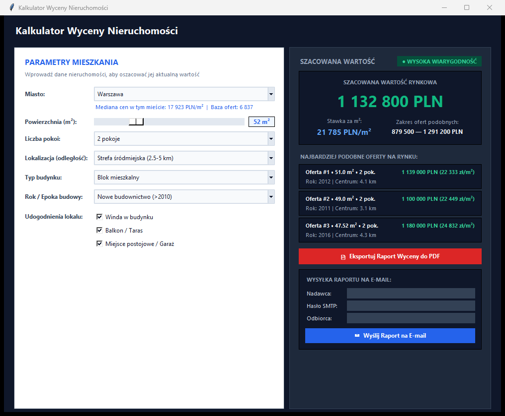

# Kalkulator Wyceny Nieruchomości (Model k-NN)

**Tech Stack:** Python 3.11 | Scikit-learn (k-NN) | Pandas | NumPy | Joblib | Tkinter (GUI) | fpdf2 | SMTP | Git

Aplikacja desktopowa do szacowania wartości mieszkań na rynku wtórnym i pierwotnym w 7 największych aglomeracjach w Polsce. Wykorzystano zbiór 21 501 surowych ogłoszeń z serwisu Otodom (czerwiec 2024), z którego po procesie czyszczenia, deduplikacji i selekcji rynków wyodrębniono bazę 17 161 ofert analitycznych.

---

## Interfejs aplikacji



---

## Cel i metodologia projektu

W projekcie zastosowano algorytm k-Najbliższych Sąsiadów (k-NN), odpowiadający rzeczoznawczemu podejściu porównawczemu (metoda korygowania ceny średniej / porównywania parami). Wycena lokalu wynika bezpośrednio z cech fizycznych najbardziej zbliżonych mieszkań na danym rynku miejskim.

Przebieg wyceny:
1. Pobranie parametrów nieruchomości (miasto, metraż, liczba pokoi, odległość od centrum, rok budowy, typ budynku, winda, balkon, garaż).
2. Wyszukanie w bazie danego miasta **5 najbardziej zbliżonych fizycznych ofert** na podstawie znormalizowanych i zważonych cech techniczno-lokalizacyjnych.
3. Wyliczenie stawki za metr kwadratowy jako średniej ważonej odwrotnością odległości w przestrzeni cech (lokale bardziej podobne mają wyższy wpływ na wynik).
4. Prezentacja szacunkowej wartości rynkowej, stawki za m², zakresu cenowego oraz **3 najbardziej zbieżnych ofert odniesienia** z bazy.

Podejście to zapewnia pełną interpretowalność wyniku – wycena jest poparta konkretnymi lokalami referencyjnymi.

---

## Przygotowanie danych i potok ETL

Przetwarzanie danych źródłowych zrealizowano w dedykowanym potoku `scripts/prepare_data.py`:

```text
[data/raw/apartments_pl_2024_06.csv] (21 501 surowych rekordów z Otodom)
                      │
                      ▼
        [scripts/prepare_data.py]
  ├── 1. Deduplikacja techniczna i przestrzenna (ID, koordynaty, cena, metraż)
  ├── 2. Selekcja 7 głównych aglomeracji miejskich
  ├── 3. Eliminacja anomalii i błędów logicznych (ceny skrajne, piętro > kondygnacje)
  ├── 4. Trening modeli k-NN per miasto z wagami cech
  ├── 5. Ewaluacja statystyczna (R2, MAE, MAPE vs Baseline na próbie testowej 20%)
                      │
         ┌────────────┴────────────┐
         ▼                         ▼
[data/processed/apartments_top7_cleaned.csv]    [data/processed/knn_models.joblib]
(czysta baza 17 161 ofert analitycznych)       (zserializowane modele, skalery i indeksy)
                                                           │
                                                           ▼
                                                [Kalkulatormieszkania.py] (GUI / PDF / SMTP)
```

Etapy przetwarzania:
* **Deduplikacja techniczna i przestrzenna:** usunięcie duplikatów identyfikatorów ogłoszeń oraz eliminacja 537 powtórzonych ofert o identycznej lokalizacji (współrzędne GPS), cenie i metrażu (oferty wieloagencyjne).
* **Selekcja aglomeracji:** zawężenie bazy do 7 głównych miast (Warszawa, Kraków, Wrocław, Gdańsk, Poznań, Szczecin, Łódź).
* **Eliminacja anomalii i błędów logicznych:** wykluczenie rekordów o nierealistycznych stawkach za m² (<3 500 PLN oraz >50 000 PLN), skrajnych metrażach (<15 m² oraz >300 m²) oraz logicznych błędach wprowadzania (np. kondygnacja wyższa niż całkowita liczba pięter w budynku, rok budowy <1800 lub >2026).
* **Standaryzacja cech:** uzupełnienie braków danych medianami w obrębie danego rynku, kodowanie zmiennych kategorycznych (typ budynku, udogodnienia) oraz skalowanie standaryzujące (`StandardScaler`) z uwzględnieniem wag rynkowych (metraż: 2.5, pokoje: 2.0, centrum: 1.5, rok: 1.2, udogodnienia: 0.7–0.9).

---

## Ewaluacja modelu

Ewaluację przeprowadzono na niezależnej próbie testowej (20% danych) odrębnie dla każdego rynku miejskiego. Jako punkt odniesienia (baseline) przyjęto model naiwny oparty na medianie stawki za m² w danym mieście pomnożonej przez metraż lokalu:

| Aglomeracja | Błąd modelu bazowego (mediana) | Błąd modelu k-NN (MAPE) | Zysk dokładności | Średni błąd kwotowy (MAE) | Baza ofert w mieście |
|:---|:---:|:---:|:---:|:---:|:---:|
| **Szczecin** | 19.7% | **13.5%** | **+6.2 pkt proc.** | 77 500 PLN | 638 |
| **Wrocław** | 15.8% | **10.9%** | **+4.9 pkt proc.** | 84 400 PLN | 2 225 |
| **Warszawa** | 16.5% | **12.1%** | **+4.4 pkt proc.** | 134 400 PLN | 6 837 |
| **Gdańsk** | 21.6% | **17.5%** | **+4.1 pkt proc.** | 171 000 PLN | 1 888 |
| **Kraków** | 15.8% | **11.9%** | **+3.9 pkt proc.** | 114 600 PLN | 3 121 |
| **Poznań** | 14.4% | **11.7%** | **+2.7 pkt proc.** | 78 500 PLN | 780 |
| **Łódź** | 14.9% | **13.3%** | **+1.6 pkt proc.** | 55 400 PLN | 1 672 |

### Wnioski analityczne:
* **Poziom błędu (11–13% MAPE):** Biorąc pod uwagę brak danych o standardzie wykończenia lokalu oraz brak dokładnego adresu ulicznego, błąd rzędu 11–13% stanowi stabilny poziom predykcji masowej.
* **Specyfika rynku gdańskiego (błąd 17.5%):** W Gdańsku głównym czynnikiem determinującym ceny jest bliskość pasa nadmorskiego (Jelitkowo, Brzeźno) oraz segment inwestycyjny pod najem turystyczny. Uwzględnienie jedynie odległości od Śródmieścia stanowi w tym przypadku ograniczenie wektora cech.
* **Niski zysk dokładności w Łodzi (+1.6 pkt proc.):** Rynek w Łodzi charakteryzuje się dużą homogenicznością cenową zasobu mieszkaniowego (dominacja bloków z wielkiej płyty), przez co proste oszacowanie medianowe jest trudniejsze do znacznego pobicia przez model wielocechowy.

---

## Ograniczenia modelu i przyjęte założenia

* **Ceny ofertowe a transakcyjne:** Zbiór danych obejmuje ogłoszenia z serwisu Otodom (czerwiec 2024). Ceny ofertowe zawierają z reguły 3–7% bufora negocjacyjnego względem faktycznych cen transakcyjnych notowanych w rejestrach cen nieruchomości.
* **Brak cech jakościowych wykończenia:** Źródłowy zbiór nie zawierał ujednoliconej informacji o stanie technicznym lokalu (stan deweloperski, do remontu, wysoki standard), co wyznacza naturalną granicę błędu resztowego.
* **Pominięcie cechy kondygnacji:** Analiza reszt modelu wykazała, że różnica cenowa wynikająca z piętra po skontrolowaniu pozostałych parametrów wynosi poniżej 1.5% (wartość poniżej poziomu błędu modelu). Ponadto w 17% rekordów brakowało informacji o piętrze. W związku z tym zrezygnowano z wprowadzania arbitralnych korekt procentowych i nie umieszczono tego pola w formularzu, eliminując nieaktywne kontrolki interfejsu.
* **Charakter narzędzia:** Aplikacja służy do wstępnej weryfikacji i analizy porównawczej cen ofertowych; nie stanowi formalnego operatu szacunkowego.

---

## Funkcjonalności

* **Szacowanie wiarygodności:** Wyznaczanie poziomu wiarygodności na podstawie średniego dystansu do sąsiadów oraz stopnia uogólnienia kryteriów (wybór opcji „Dowolny” obniża ocenę do umiarkowanej).
* **Walidacja danych:** Kontrola logiczna relacji parametrów (ostrzeżenie przy powierzchni poniżej 9 m² przypadającej na jeden pokój).
* **Eksport do formatu PDF:** Generowanie ustandaryzowanego raportu z parametrami lokalu i danymi ofert porównawczych z obsługą polskich znaków ([przykładowy raport](reports/Raport_Wyceny_Warszawa_Przyklad.pdf)).
* **Asynchroniczna wysyłka e-mail:** Komunikacja z serwerem SMTP realizowana w osobnym wątku roboczym z synchronizacją do pętli zdarzeń GUI, co zapobiega blokowaniu interfejsu użytkownika.
* **Bezpieczeństwo konfiguracji:** Separacja poświadczeń serwera pocztowego w pliku środowiskowym `.env` z wykorzystaniem szablonu `.env.example`.

---

## Instrukcja uruchomienia

### 1. Klonowanie repozytorium i instalacja zależności:
```bash
git clone https://github.com/twoj-login/kalkulator-wyceny-nieruchomosci.git
cd kalkulator-wyceny-nieruchomosci
pip install -r requirements.txt
```

### 2. Konfiguracja poczty (opcjonalnie):
W przypadku korzystania z modułu wysyłki raportów należy utworzyć plik `.env` na podstawie szablonu:
```bash
cp .env.example .env
```


### 3. Uruchomienie aplikacji:
```bash
python Kalkulatormieszkania.py
```

Wytrenowane modele znajdują się w katalogu `data/processed/`. W celu ponownego przeliczenia potoku ETL oraz modeli na surowych danych należy uruchomić:
```bash
python scripts/prepare_data.py
```

---

## Struktura repozytorium

```text
├── data/
│   ├── raw/
│   │   └── apartments_pl_2024_06.csv       # Surowe dane źródłowe (21 501 rekordów z Otodom)
│   └── processed/
│       ├── apartments_top7_cleaned.csv     # Zbiór po czyszczeniu i deduplikacji (17 161 ofert)
│       ├── knn_models.joblib               # Zserializowane modele k-NN per miasto
│       └── parametry_wyceny.json           # Statystyki rynków i metryki ewaluacji
├── reports/
│   ├── screenshots/
│   │   └── app_preview.png                 # Zrzut ekranu interfejsu kalkulatora
│   └── Raport_Wyceny_Warszawa_Przyklad.pdf # Przykładowy wygenerowany raport PDF
├── scripts/
│   └── prepare_data.py                     # Potok ETL, trening modeli i obliczanie baseline
├── .env.example                            # Szablon konfiguracji zmiennych środowiskowych
├── .gitignore                              # Reguły wykluczeń systemu Git
├── requirements.txt                        # Zależności biblioteczne ze stabilnymi zakresami wersji
├── Kalkulatormieszkania.py                 # Kod źródłowy aplikacji desktopowej (Tkinter / k-NN)
└── README.md                               # Dokumentacja techniczna projektu
```
